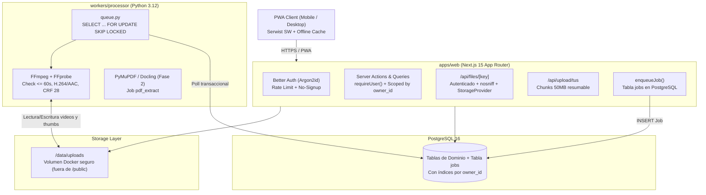

# Arquitectura: Bitácora de Asados

## 1. Visión General
**Bitácora de Asados** es una PWA (Progressive Web App) personal, mobile-first y completamente responsive en escritorio, concebida para documentar cursos y talleres de asados, técnicas parrilleras, recetas detalladas, notas ancladas en PDFs de estudio, enlaces a redes sociales y videos propios con transcodificación en segundo plano.

Aunque en su versión MVP opera para un único usuario, todo el modelo de datos e interfaces lógicas implementan aislamiento por `owner_id`, permitiendo una transición inmediata a entorno multi-usuario en fases posteriores.

---

## 2. Diagrama de Arquitectura

---

## 3. Modelo de Datos y Entidades
- **User / Session / Account / Verification**: Esquema Better Auth con hash Argon2id y deshabilitación de auto-registro (únicamente se inicializa mediante script de seed).
- **Course & ClassSession**: Agrupación cronológica y académica de talleres, instructores, academias y sesiones.
- **Material**: Documentos PDF subidos con verificación de magic bytes (`%PDF-`), metadatos de autor y fuente.
- **Annotation**: Anotaciones precisas en PDFs usando coordenadas normalizadas de `react-pdf-highlighter-extended` (bounding box, rectángulos de selección, texto citado, color y notas).
- **Recipe**: Ficha técnica con ingredientes estructurados (cantidad, unidad, nombre), pasos mediante editor enriquecido TipTap (guardado como JSON AST y texto plano derivado), tiempos de cocción/reposo y temperaturas objetivo.
- **Technique**: Ficha de habilidades parrilleras (puntos clave, errores comunes, descripción TipTap).
- **Reference**: URLs externas a redes (YouTube, Instagram, TikTok, X) obtenidas mediante oEmbed/OpenGraph con resolución protegida contra SSRF (allowlist y bloqueo de IPs privadas/loopback).
- **Media**: Gestión de imágenes y videos propios (duración máxima 60 segundos, subidas por partes con tus).
- **Job**: Cola de tareas persistida en base de datos con recuperación transaccional sin bloqueos concurrentes.

---

## 4. Estrategia de Seguridad
1. **SSRF Guard**: Toda resolución externa de OpenGraph u oEmbed valida el host contra una lista blanca permitida y resuelve la IP mediante DNS antes del `fetch`, rechazando terminantemente rangos de red privados (RFC 1918), loopback (`127.0.0.1`), link-local (`169.254.169.254`) y direcciones IPv6 reservadas.
2. **Validación de Archivos por Magic Bytes**: Se descartan archivos basándose en sus primeros bytes en lugar de confiar en la extensión o el encabezado MIME del cliente.
3. **Storage Aislado**: Los archivos nunca residen en `public/`. Se acceden exclusivamente mediante streaming autenticado con cabeceras `Content-Disposition: inline/attachment` y `X-Content-Type-Options: nosniff`.
4. **Rate Limiting**: Protección activa en el endpoint de autenticación y carga de archivos para prevenir ataques de fuerza bruta.
